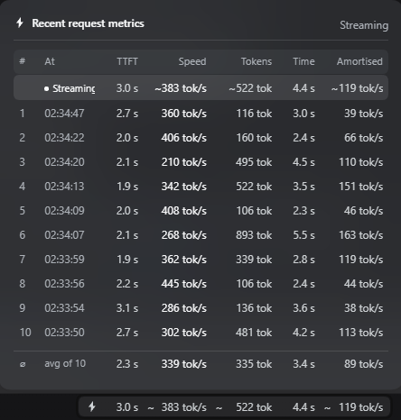
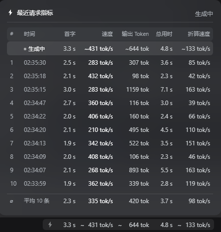

# dsh-recent-usage-metrics

**English** · [简体中文](README.md)

Geek-level request metrics for DSH. It adds a third level — **Geek / 极客** — to the
native **Performance & usage** preference in Settings → General, and while that level
is active it keeps a live reading of the newest request in the composer status row
plus a glass drawer with the last ten requests.



The drawer open: the step still streaming sits on top (its first-token figure climbing,
speed shown as `—`), the last ten requests follow newest first, and their average closes
the list. The status pill sits below it, its columns aligned with the table's.

The UI is bilingual and follows the DSH language setting. The same drawer in Chinese:



## What you get

**Settings → General → Performance & usage** now offers three levels:

| Level | Behaviour |
| --- | --- |
| Compact / 简洁 | Shipped behaviour, unchanged |
| Detailed / 详细 | Shipped behaviour, unchanged |
| **Geek / 极客** | Everything below |

Compact and Detailed keep writing the shipped `ui-chat` → `performanceUsage` field, so
they behave exactly as before and stay in sync with the shipped row's data. Geek is a
separate durable flag, because the shipped Chat schema only accepts two values.

**Composer status row** (left of the shipped `55 轮 2307 步` pill):

```
⚡ 2.3 s   445 tok/s   1024 tok   4.6 s   223 tok/s
```

time to first token · live generation speed · output tokens · total time · amortised
speed (output ÷ total), separated by whitespace only. The pill reproduces the shipped
statistics pill: the same `--dsw-alias-label-tertiary` foreground for both the text and
the icon (the native pills never tint their glyph), and the same type scale. Height comes
from padding + line-height, so it matches the native row.

Each figure's digits are reserved with a **fixed width on the number element only** —
never on the wrapping cell, which also carries the unit and would otherwise clip it. The
estimate marker is a permanently reserved 1ch span that only toggles its paint. A value
growing from `3.1` to `57.8`, a speed dropping from `328` to `9`, a `--` placeholder, and
a `~` appearing or disappearing all leave the pill's width byte-identical — the centred
composer row never shifts.

The budgets come from the real distribution of a 433-reading session log, and each
formatter is written to stay inside its budget:

| Slot | Digits | Why that is enough |
| --- | --- | --- |
| first token / total | `4.5ch` | `57.8` normally; from 100 s up it prints whole seconds (`126`) |
| speed / amortised | `4.5ch` | p50 `85`, max `328` in the log |
| output tokens | `5.5ch` | p50 `219`; `123456` collapses to `123k` |

The pill and the drawer use **disjoint class names** (`dsh-rum-part` vs `dsh-rum-col`).
Sharing one cell class let the drawer's ellipsis rule clip the pill's units — the regression
that produced digits with a truncated ` s` / ` tok/s`.

Drawer columns are **measured from the pill at runtime**, not derived from `ch`. `ch` is
the advance of `0`, while `tok/s` and the thin `s` are narrower, so an arithmetic column
can never sit exactly under the rendered cell. On open the plugin reads each
`[data-metric]` cell's `getBoundingClientRect().width` and publishes one custom property
per metric (`--dsh-rum-col-ttft`, `--dsh-rum-col-speed`, `--dsh-rum-col-tokens`,
`--dsh-rum-col-total`, `--dsh-rum-col-amortized`), which the row grid consumes. A
`ResizeObserver` on the pill re-measures after a font-scale change or a metric swap, and a
`ch` expression stays as the fallback for the frame before measurement lands.

| Drawer column | Consumes | Sits under |
| --- | --- | --- |
| first token | `--dsh-rum-col-ttft` | the pill's first-token cell |
| speed | `--dsh-rum-col-speed` | the pill's speed cell |
| output tokens | `--dsh-rum-col-tokens` | the pill's token cell |
| total | `--dsh-rum-col-total` | the pill's total-time cell |
| amortised | `--dsh-rum-col-amortized` | the pill's amortised cell |

Two further details make the edges actually coincide:

- **Content edges, not box edges.** The pill pads its content by 8px, while the drawer
  stacks 16px of its own padding with a row's 6px. Aligning the two *boxes* therefore
  leaves the numbers visibly inset. Both insets are measured
  (`drawerContentInset` / `pillContentInset`) and subtracted, so the last figure in the
  drawer lines up with the last figure in the pill.
- **Spare width goes left.** The drawer keeps a `min-width` so its own headers are not
  truncated; each row uses `justify-content: end`, pushing any surplus to the left so the
  final column stays flush. The drawer is also re-placed on the next animation frame,
  because the first pass can run before the measured columns have been applied.

Click the pill to open the drawer; click it again, or press Escape, or click outside, to
close it. There is no hover-open and no tooltip.

## Four states

The plugin sorts "what is happening right now" into four phases, each with its own glyph and
wording:

| State | Decided by | Pill icon | Drawer header |
| --- | --- | --- | --- |
| **Model writing** | `model` is `null` | ⚡ pulsing | `Streaming` |
| **Tools running** | `model` set, `endTime` `null` | T pulsing | `Calling tools` |
| **Compacting** | newest compaction `running` | ≡ pulsing | `Compacting context` |
| **Compacted** | compaction finished, no request since | ≡ still | `Context compacted` |
| **Idle** | otherwise | ⚡ still | `Last N` |

When a compaction finishes the pill says "Context compacted" and stops pulsing, and it stays
that way until the next request starts — at which point the writing phase takes over again.

### Compaction is its own activity

It belongs to no step: it is opened by `compaction/start` and closed by `compaction/end`, it
lives on the turn's `compactions[]`, it runs between two steps, and it can take tens of
seconds. No step is running during that time, so the pill used to keep showing the previous
step's figures and the pause looked like a hang.

It has no first token, no generation rate and no streamed token count — all three belong to a
settled reply. So the drawer's columns are filled like this:

| Column | While compacting | Once compacted |
| --- | --- | --- |
| First token | `—` | `—` |
| Speed | `Compaction` | `Compaction` |
| Tokens | `—` | the real figure (e.g. `4.9k tok`) |
| Time | counts up live | frozen at `wall` |
| Amortised | `—` | `output ÷ wall` |

The total is `wall` (`endTime − startTime`): a log fact, so a reload shows the same span.
A compaction row is excluded from the footer average — its total is wall-clock time, and
folding it into the mean would pull it toward a number describing neither case.

### Which model compacts

The summarizer picks, in order: an explicitly configured `summarizationProvider/Model` → **the
model the last request used** → the Agent's own model. The default is the second, because
replaying the whole conversation is only cheap when it hits the same provider's KV cache.

`compaction/summary` records the model actually used, so **after** a compaction the real name
is shown; **while** one runs the log has no such record yet, so the chat model is named, and
the generic wording is the last resort.

### Hover hints

Every drawer column and every header carries a hint:

| Where | Content |
| --- | --- |
| Clock column | the full timestamp `11-06 10:47:41.828` |
| Speed column | the model that served that row |
| Tokens column | input tokens (with thousands separators, e.g. `370,683 tok`) and cache hit rate |
| Time column | how much of the request was tool time, both summed and parallel-merged; the live row says "Calling X · N.N s elapsed" while tools run |
| Headers | what the column measures (the `#` header draws the four state glyphs and swatches for the two row colours) |

**Row highlights:**

| Trigger | Colour | Frequency |
| --- | --- | --- |
| The request switched models | business blue (text + left bar) | 0.7% |
| Cache hit below 90% | warn yellow (text + left bar) | 0.9% |

When both hold, the text takes the warn colour and the bar keeps the business colour. A
compaction row never takes the cache highlight.

**A model switch and a configuration change are not the same thing.** A `request/header` only says
the routed configuration changed — enabling or disabling a plugin rewrites the tool list and writes
a header without touching the model. On a real session, only 7 of 27 headers were genuine model
switches. Blue therefore appears only when the model itself differs; a configuration change without
a model change shows up as a cold cache, coloured yellow, with the tool-list movement named in the
row-number hint.

**Where the model name comes from:** a `request/header` inside the step's window means a switch
and supplies the model; otherwise the previous step's model carries over, and a landed reply
overrides both via `assistant/message.source`. The live row follows the same rule, so the model
is visible while the reply is still streaming.

The hints are a real overlay rather than `title`: `title` can only show plain text, and the
`#` header has to draw glyphs.

## How the numbers are measured

Everything is derived in the browser from the Chat snapshot the Conversation layer
already maintains — the plugin adds no Host service, session event, or projection.

- **Time to first token** — `timing.firstTokenTime − timing.stepStartTime`, the recorded
  moment the request was issued and the moment the first visible delta arrived.
- **Total time** — `timing.completedTime − timing.stepStartTime`.
- **Live speed** — output tokens ÷ decode time (`completedTime − firstTokenTime`).
- **Output tokens** — the provider's own `usage.outputTokens`, which is the authority.
  It is read from `assistant/message.data.usage` (verified against a real session log:
  262 of 262 settled steps carried it). `reasoningTokens` is already included in that
  count and is never added on top. OpenAI-shaped `completionTokens` spellings are also
  accepted for adapters that forward their usage verbatim.
- **Amortised speed** — output tokens ÷ total time.

The character estimate is a genuine fallback, not the normal path: it is used only for a
step whose provider returned no usage at all (an interrupted or failed request), and such
a row is marked `~`.

Its coefficients are calibrated, not guessed. The content is not homogeneous: prose and
reasoning tokenize near 4 ASCII characters per token, while tool-call arguments are JSON —
short keys, punctuation, quoted values — and tokenize markedly worse, near 2.5. Measured
against the provider's own `outputTokens` over 729 settled steps of a real session log,
using the median absolute log error:

| Rule | Median error | Estimate ÷ actual (p50) |
| --- | --- | --- |
| one shared `/4` for everything | 0.361 | 0.70 |
| prose `/4`, tool args `/2.5` (shipped) | **0.128** | **1.00** |

Splitting the two is what removed the bias. The old shared divisor systematically
under-counted by about 30%, which is why the live amortised speed read low during
generation; a fine grid search put the optimum at 0.125, so the shipped rule is within
three thousandths of it. CJK stays at the conventional one token per character: the search
suggested a lower cost, but only 45% of those steps contain any CJK, so that term is
poorly identified in this sample and a fitted value would be noise.

### Tool arguments while they stream

`legacy.partial.blocks` does **not** carry argument text during a call. The store's
`tool-call-delta` branch copies `argsRaw` unchanged, so it stays an empty string until
`block-end` fills it in one go. Counting only `blocks` therefore froze the live figure for
the whole write phase — and that phase dominates real output: across 874 settled steps of
a session log, tool arguments were a median **93%** of the estimated tokens, and 98% of
steps had them.

The fragments do exist during the call. They accumulate on the call's own `args.chunks`
view, which `legacy.runningCalls` exposes for a call still in its `preparing` phase, so the
live count reads them there and weights them at the tool coefficient. This is what makes
the number climb while a file is being written instead of jumping when it finishes.

The streaming row is approximate by nature — the Chat snapshot exposes the running step
only as `legacy.partial` (turn, step, blocks), with no per-step start time. Two things keep
that approximation honest:

- **A step-level origin.** The settled figure is `firstToken − stepStart`, so the live one
  must use the same origin. Subtracting the *turn* start instead overstates TTFT by
  everything earlier in the turn: in a real session log the gap from turn start to a later
  step's start has a **174 s median** and reaches **2720 s**. That is why a live reading
  could show tens of seconds while reasoning yet a few seconds once the step settled.
- **A tool result, not `completedTime`.** `timing.completedTime` is the `assistant/message`
  time, which lands *before* the step's tools run. Using it as the next step's origin counts
  the whole tool execution into that step's TTFT — measured, that gap has a 243 ms median but
  reaches **120 s**, which is exactly the "six seconds while streaming, two once it settles"
  symptom. A step's last `tool/result` sits within 1 ms of its own `step/end` and a median
  9 ms before the next `step/start`, making it the tightest origin a browser-only plugin can
  reach. Attribution runs on the **seq window**, not timestamps: a resumed log replays steps
  and times repeat. Over 1113 steps the origin error fell from p50 100 ms / p99 20.8 s to
  **p50 9 ms / p99 486 ms**, and steps off by more than a second from 114 to **1**. A step
  that ran no tools falls back to its own `completedTime` (it was the turn's final answer, so
  nothing follows it), and a turn's first step to the turn's start (26 ms earlier).
- **First delta, not first visible text.** The settled `firstTokenTime` counts reasoning and
  tool-call deltas too, and `legacy.partial` only appears once the step has visible content —
  so the moment a new partial key appears *is* the first-token moment.
- **Counting from `step/start`, not from the first visible block.** Chat's `legacy.partial`
  waits for a visible block — a **1.9 s median** (p90 2.9 s) after the step begins, which is
  most of what a first-token latency measures. Reading only Chat therefore made the figure
  appear at its final value with no visible growth. The Trajectory domain instead opens its
  assistant record on `step/start` itself, and that record reaches the snapshot's `requests[]`
  with `status: "running"` and an exact `startedAt` — `step/start` is a location boundary, so
  the conversation assembler raises the publication priority from the definition's declared
  `none` to `immediate`. The plugin uses that to know the step is live and where it started,
  so the figure climbs as `now − startedAt` and then locks to `firstTokenTime − startedAt`,
  the same subtraction the settled row performs.

## First-token time for replayed history

Seeding the drawer from an existing conversation used to leave the first-token column
empty, even though the Trajectory panel showed a value for the same steps. The reason is
a data-flow fact, not a missing calculation: `timing.firstTokenTime` is *streamed* state.
The Chat store accumulates it from live token deltas, and the session log stores no live
chunks — a real log held 787 settled messages and **zero** `assistant/live-chunk` events.
A step replayed from that log therefore has no such field.

The value is still recoverable. Every settled message carries `data.stream`, the whole
chunk timeline with per-fragment timestamps, and the Trajectory domain rebuilds the mark
from it (`firstTokenTime ?? assistantStreamFirstTokenTime(event.data.stream)`), summing
`time0 + dt` across each packed run. That is why its panel can date history that the Chat
snapshot cannot.

The plugin reads those times from the Trajectory snapshot, which a slot entry reaches
through the standard `useTrajectory` hook, and dates its rows with them. Two consequences
worth knowing:

- The Trajectory domain is another plugin's projection, so its times can arrive *after*
  the plugin seeded. Rows that were stored undated are repaired in place when that happens
  (`backfill`), instead of staying at `--` for the rest of the session.
- A value that streamed live is never overwritten: the repair only touches rows whose
  first-token time is still absent.

If a composition has no Trajectory domain, `useTrajectory` is simply absent, no index is
built, and undated rows keep showing `--` — the previous behaviour, with no error.

## Install

Published to npm as `dsh-recent-usage-metrics`:

```powershell
# from the dsh GUI's Plugin Manager, or directly:
npm install dsh-recent-usage-metrics
```

It can also be added to the profile's `package.json` dependencies and installed from there.

**Development mode**: point the profile dependency at this directory with `link:`, so editing
`client/client.js` and reloading the page picks up the change. Host-side code never needs a
restart because there is none.

## Release

Pushing a `v*` tag publishes automatically through GitHub Actions, authenticated with OIDC
trusted publishing — **no npm token is involved**.

```powershell
npm version patch          # bump the version and create the tag
git push --follow-tags     # push, and the release publishes itself
```

The workflow first checks that the tag matches the `package.json` version and fails on a
mismatch, so a wrong version cannot slip out. Published tarballs carry a provenance statement,
visible on the package page.

## Layout

| Path | Purpose |
| --- | --- |
| `client/client.js` | The whole feature: settings row, status reading, drawer |
| `lib/index.js` | Empty Host half — makes the package a Loader entry so `./client` is published |
| `cordis.patch.yml` | The one inserted Loader row |
| `locale/en.json`, `locale/zh.json` | Plugin Manager title and description |
| `icon.svg` | Plugin icon |
| `CHANGELOG.md` | What changed in each version |
| `.github/workflows/publish.yml` | Publishes to npm when a tag is pushed |
| `test/lifecycle.cjs` | Runs the real client against a DOM/hook shim: metrics, ten-row cap, insertion order, click/open, disposal |
| `test/repro-coldstart.cjs` | Regression: a cold page must paint Chinese and stay switchable both ways |
| `test/repro-hmr.cjs` | Regression: a reload must not collide with the live dictionary claim |
| `test/repro-log.cjs` | Verifies against a real session log (see below); skips itself when none exists |

```powershell
node test/lifecycle.cjs
node test/repro-coldstart.cjs
node test/repro-hmr.cjs
$env:ELECTRON_RUN_AS_NODE='1'; & "C:\Cinstall\ProgramTools\DSH\DeepSeek Harness.exe" test\repro-log.cjs
```

## Verifying against a real session log

The Statistics page's figures come from the durable session log on disk:

```
~/.dsh/sessions/<workspace>/<session-id>/session.v4.jsonl.zstd
```

`test/repro-log.cjs` finds the newest one, folds it with the Statistics view's own
`foldEvent` / `stepMetrics` algorithm, then checks the properties the drawer depends on:
every step has a start time, first-token latency is non-negative and never exceeds the step's
wall time, settled steps have a total, running steps do not, and the drawer selects the newest
ten rows in descending order.

That is far more reliable than comparing a few rows on screen: one run covers thousands of
steps.

Two traps the script handles:

- **The log is many concatenated zstd frames.** A single `zstdDecompressSync` call returns
  only the first frame — a few hundred bytes. The frames must be split at the magic
  `28 B5 2F FD` and decompressed one by one, otherwise all you get is the `session` header.
- **The first-token time lives in packed records.** The log contains no
  `assistant/live-chunk` events (client-only, never persisted); the moment is inside the
  `reasoning-chunks` / `tool-call-chunks` records of `assistant/message.data.stream`, as
  `time0` plus the cumulative `dt` offsets. Reading only loose `chunk` records leaves the
  first-token time at `--` for nearly every step (measured: 0% → 96%).

## Language after a restart

`locale` is declared as a **hard dependency** (`inject: ['slots', 'locale']`) and `apply`
reads `ctx.locale`. Probing with `ctx.get('locale')` was a real defect with a confusing
symptom: the locale plugin itself waits on the connection, settings and remotes services,
so on a cold page this plugin could apply first, read `undefined`, skip registering its
dictionaries, and then render through a dictionary-less `t` — English, or raw keys, that
stayed English even after switching the language back.

`configForms` is optional (a profile may compose this bundle without the settings domain),
so it is awaited with `ctx.inject(['configForms'], …)` rather than probed once. A single
probe would latch the settings row onto the fallback preference for the whole session if
the domain arrived late. Both choices follow the plugin guidance: required services go in
`inject`, optional ones go in `ctx.inject`.

The dictionary claim is parked on `globalThis` so a hot reload can release the previous
generation's claim before registering; otherwise the second `register` for the namespace
would throw and leave the UI dictionary-less — the same visible symptom by another route.

## Notes

- The row is registered into the shipped `performance-usage` cell with `priority: -1`
  and the shipped `order: 30`, so it renders in the same place and the shipped cell is
  shadowed rather than duplicated.
- Everything that outlives a render is created inside `ctx.effect`, so disabling the
  plugin restores the shipped row and removes every listener and style.
- **Only the Geek flag is kept in `localStorage`** (`dsh.recentUsageMetrics.mode.v1`).
  The drawer's history is no longer persisted; it is derived from the session's own
  statistics, explained below.

## Where the drawer's rows come from

Each row reads the **same data the shipped Statistics page renders** (the `stats` view
target) instead of computing its own copy:

```js
const target = uiConversation.binding(sessionId).target('stats')
```

That data comes from the Host-side `sessionStats` fold over the session log, and each step
carries `ttft`, `model`, `decode`, `tps`, `output` and `wall`.

**How the columns map:**

| Drawer column | Field | Note |
| --- | --- | --- |
| At | `startTime` | the `step/start` moment, same as the Statistics view |
| TTFT | `ttft` | `firstToken − startTime` |
| Speed | `tps` | `output ÷ decode` |
| Tokens | `output` | the provider's reported usage |
| **Time** | **`model`** | **model time, not the Statistics view's total** |
| Amortised | `output ÷ model` | this plugin's own figure |

**Interrupted rows:**

A request that was stopped never produced an `assistant/message`, so `model`, `decode` and
`tps` are all null. That row's **total falls back to `wall`** (`endTime − startTime`) — how
long the request actually ran before it was stopped. It is a log fact, so it survives a reload
unchanged, which is exactly what that column is for here.

**The first-token column falls back to `wall` too**, in two shapes: if the upstream never returned a
token, the first-token figure is the wait itself and equals the total; if a token had arrived,
`ttft` is already fixed and the row keeps that measurement, so the first-token figure is smaller
than the total — which is how a reader tells "it started answering and was cut off" from "it never
got to answer".

The word **"interrupted" sits in the speed column**, not the first-token column: both the
first-token figure and the total are real readings, and the only missing figure is the generation
rate, so that is the column that says why. Interrupted rows are
excluded from the footer average — their total is wall-clock time, and folding it into the mean
would pull it toward a number describing neither case — but the caption still counts all ten.

**Why the total is `model` and not `wall`:**

The Statistics view's total column is `wall = endTime − startTime`, which **includes the step's
tool calls**. A step that thinks for 11.5 s and then runs a 31 s command shows `wall` 41.9 s but
`model` 11.5 s. This plugin measures model output only, so it reports `model` — a figure that
contains no tool time by construction, and is therefore final the moment the reply lands.

**Why the figures carry `~` while streaming:**

Until the model finishes, the Host has no `usage` from the provider, so `output` is `null`. The
plugin falls back to a character estimate (coefficients fitted per content type), which is why
those figures carry `~`. The moment `usage` arrives — which is essentially the same instant the
reply completes — the measured value takes over and the `~` disappears.

**Why the history is no longer stored locally:**

The drawer used to write its history to `localStorage` under one global key, with row keys
of the form `${turn}:${step}`. **Every conversation numbers its turns and steps from 1**, so
one conversation's `1:1` collided with another's — switching conversations showed the wrong
figures and switching back showed them again. That was the reported symptom.

Now:

- Rows are rebuilt from that conversation's own statistics on every render, so there is no
  local copy that can go stale.
- A reported session change clears them immediately, so the previous conversation's rows
  never appear under the new one while its data is still arriving.
- A page reload rebuilds from the log; nothing extra needs persisting.

**A view target only exists once something subscribes** (`getSnapshot` returns `undefined`
before that). The plugin subscribes once per session at apply time. Activation is permanent
and shared, so this does not start a second fold alongside the Statistics view.

**Fallback**: in a composition without that data (`uiConversation` absent), the drawer
returns to the Chat-snapshot plus Trajectory-domain calculation and marks estimates with `~`.
That path only runs when the statistics data is missing.

**The live reading does not touch the statistics during streaming**: its fold rebuilds the
whole table on every chunk. The status pill uses a lighter path instead — the Trajectory
domain's `step/start` time plus a 150 ms local tick — and reads the statistics once each
step settles. That keeps the counting-up effect without adding fold work on every chunk.
