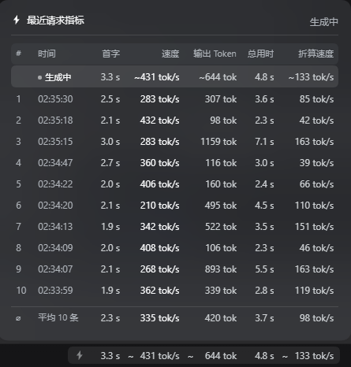
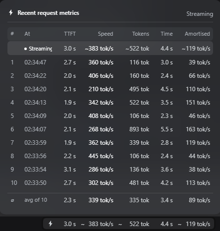

# dsh-recent-usage-metrics

DSH 的极客级请求指标。它在 **设置 → 通用 → 性能与用量** 里加入第三档 **极客**，
选中后，输入区状态行会常驻显示最新一次请求的实时读数，并可用一个磨砂玻璃抽屉
查看最近 10 次请求的完整指标。

**简体中文** · [English](README.en.md)



上图是抽屉展开的样子：顶部是正在生成的那一条（首字在增长，速度列显示 `—`），
下面按新到旧列出最近 10 次请求，底部一行是它们的平均值。
最下方是状态栏里的气泡，与抽屉各列一一对齐。

界面为中英双语，跟随 DSH 的语言设置。英文界面下的同一抽屉：



## 你会得到什么

**设置 → 通用 → 性能与用量** 现在有三档：

| 档位 | 行为 |
| --- | --- |
| 简洁 | 原生行为，不变 |
| 详细 | 原生行为，不变 |
| **极客** | 本文下面描述的全部内容 |

简洁与详细仍写入原生的 `ui-chat` → `performanceUsage` 字段，因此行为与原来完全一致，
也和原生行的数据保持同步。极客是一个独立的持久标记，因为原生 Chat 的 schema 只接受两个值。

**输入区状态行**（位于原生 `55 轮 2307 步` 气泡左侧）：

```
⚡ 2.3 s   445 tok/s   1024 tok   4.6 s   223 tok/s
```

依次为：首字时间 · 实时生成速度 · 输出 Token · 总用时 · 折算速度（输出 ÷ 总用时），
各项之间只用空白分隔。该气泡复刻原生气泡：文字与图标同样使用
`--dsw-alias-label-tertiary`（原生气泡从不给图标上色），字号体系也相同。
高度由 padding + line-height 自然撑开，因此与原生的那一行齐平。

每个数字都以**固定宽度写在数字元素自身上**——绝不写在外层格子上，因为格子里还有单位，
写窄了会把单位裁掉。估算标记是一个常驻占位的 1ch 元素，只切换可见性。
于是「`3.1` 长成 `57.8`」「速度从 `328` 掉到 `9`」「`--` 占位」「`~` 出现或消失」
这些变化都让气泡宽度逐字节不变——居中的输入区永远不会位移。

这些宽度来自一份 433 条读数的真实会话日志的分布，每个格式化函数都写得不会超出自己的预算：

| 槽位 | 位数 | 为什么够 |
| --- | --- | --- |
| 首字 / 总用时 | `4.5ch` | 通常 `57.8`；超过 100 秒就打印整秒（`126`） |
| 速度 / 折算速度 | `4.5ch` | 日志中 p50 `85`，最大 `328` |
| 输出 Token | `5.5ch` | p50 `219`；`123456` 折叠为 `123k` |

气泡与抽屉使用**互不相交的类名**（`dsh-rum-part` vs `dsh-rum-col`）。
曾因二者共用同一个单元格类名，抽屉的省略号规则把气泡的单位也裁掉了——
这正是「数字后面跟着被截断的 ` s` / ` tok/s`」那次回归的成因。

抽屉的列宽是**在运行时从气泡实测得到的**，不是用 `ch` 推算的。`ch` 是字符 `0` 的推进宽度，
而 `tok/s` 和细窄的 `s` 实际都比它窄，所以算术推算出来的列永远无法精确落在渲染出的格子下面。
打开抽屉时，插件读取每个 `[data-metric]` 格子的 `getBoundingClientRect().width`，
按指标名各发布一个自定义属性（`--dsh-rum-col-ttft`、`--dsh-rum-col-speed`、
`--dsh-rum-col-tokens`、`--dsh-rum-col-total`、`--dsh-rum-col-amortized`），由行的 grid 消费。
气泡上挂一个 `ResizeObserver`，在字体缩放或指标变化后重新测量；
测量落地前的那一帧由 `ch` 表达式兜底。

| 抽屉列 | 消费的变量 | 对齐到 |
| --- | --- | --- |
| 首字 | `--dsh-rum-col-ttft` | 气泡的首字格 |
| 速度 | `--dsh-rum-col-speed` | 气泡的速度格 |
| 输出 Token | `--dsh-rum-col-tokens` | 气泡的 Token 格 |
| 总用时 | `--dsh-rum-col-total` | 气泡的总用时格 |
| 折算速度 | `--dsh-rum-col-amortized` | 气泡的折算速度格 |

还有两个细节才让边缘真正重合：

- **对齐内容边缘，不是容器边缘。** 气泡的内容右内边距是 8px，而抽屉是自身 16px
  加上一行的 6px。因此对齐两个*容器*会让数字明显内缩。两边的内边距都被实测
  （`drawerContentInset` / `pillContentInset`）并相减，抽屉里最后一个数字才与气泡里
  最后一个数字齐平。
- **富余宽度归到左侧。** 抽屉保留 `min-width` 以免自己的表头被截断；每一行用
  `justify-content: end`，把多余的空间推向左方，让最后一列保持贴右。
  抽屉还会在下一个动画帧重新定位一次，因为首次定位可能跑在实测列宽生效之前。

点击气泡打开抽屉；再次点击、按 Esc、或点击外部即可关闭。没有悬停打开，也没有悬停提示。

## 四种状态

插件把「现在在干什么」分成四段，每段有自己的图标与文案：

| 状态 | 判定 | 状态栏图标 | 抽屉右上角 |
| --- | --- | --- | --- |
| **模型输出中** | `model` 为 `null` | ⚡ 脉冲 | `生成中` |
| **工具调用中** | `model` 有值、`endTime` 为 `null` | T 脉冲 | `调用工具中` |
| **上下文压缩中** | 最近一次压缩 `running` | ≡ 脉冲 | `上下文压缩中` |
| **上下文压缩完成** | 压缩已结束、之后没有新请求 | ≡ 静止 | `上下文压缩完成` |
| **空闲** | 其余 | ⚡ 静止 | `最近 N 条` |

压缩完成后状态栏显示「压缩完成」并停止闪动，直到下一条请求发出——那时自动回到模型输出状态。

### 压缩是一种独立的活动

压缩不属于任何一步：它由 `compaction/start` 与 `compaction/end` 界定，挂在回合的
`compactions[]` 上，跑在两步之间，可以持续几十秒。在这段时间里没有步骤在跑，
所以之前只能沿用上一步的数字，看起来像是卡住了。

它没有首字、没有生成速度，也没有流式 token —— 那三项都依附于一条已结算的回复。
因此抽屉里那几列，压缩行是这样处理的：

| 列 | 压缩期间 | 压缩完成后 |
| --- | --- | --- |
| 首字 | `—` | `—` |
| 速度 | `压缩上下文` | `压缩上下文` |
| 输出 Token | `—` | 实际值（如 `4.9k tok`） |
| 总用时 | 实时递增 | 冻结为 `wall` |
| 折算速度 | `—` | `output ÷ wall` |

总用时取 `wall`（`endTime − startTime`）：这是日志事实，刷新后仍是同一个数。
压缩行不计入底部平均值——它的总用时是墙钟时间，混进均值会拉偏。

### 压缩用哪个模型

压缩的模型按顺序取：显式配置的 `summarizationProvider/Model` → **最后一次请求实际用的模型**
→ Agent 自身的模型。默认走第二条，因为重放整段对话时复用同一个模型才能命中 KV 缓存。

`compaction/summary` 会记录实际用的模型，所以**压缩结束后**显示的是真实模型名；
**压缩期间**日志里还没有这个信息，此时显示对话模型名，拿不到则写「使用对话模型」。

### 悬浮提示

抽屉的每一列与表头都有提示：

| 位置 | 内容 |
| --- | --- |
| 时间列 | 完整时间戳 `11-06 10:47:41.828` |
| 速度列 | 该行使用的模型 |
| 输出 Token 列 | 输入 token（带千分位，如 `370,683 tok`）与缓存命中率 |
| 表头 | 该列的含义（`#` 一列用图标展示四种状态） |

**行高亮：**

| 触发 | 颜色 | 实测频率 |
| --- | --- | --- |
| 该请求切换了模型 | 业务蓝（文字 + 左侧色条） | 0.7% |
| 缓存命中低于 90% | 警告黄（文字 + 左侧色条） | 0.9% |

两者同时成立时文字取警告色、色条保留业务蓝。压缩行不参与缓存高亮。

**模型名的来源：** 本步窗口内的 `request/header` 判为切换，否则沿用上一步；回复落地后
由 `assistant/message.source` 覆盖。实时行同样适用，所以生成期间就能看到模型名。

提示是自建的浮层而不是 `title`：`title` 只能显示纯文本，而 `#` 列的说明要画出图标。

## 数字是怎么算出来的

一切都在浏览器内、从 Conversation 层本就维护的 Chat 快照推导得出——
插件没有新增任何 Host 服务、会话事件或投影。

- **首字时间**——`timing.firstTokenTime − timing.stepStartTime`，即请求发出的时刻
  与第一个可见增量到达的时刻。
- **总用时**——`timing.completedTime − timing.stepStartTime`。
- **实时速度**——输出 Token ÷ 解码时长（`completedTime − firstTokenTime`）。
- **输出 Token**——上游自己的 `usage.outputTokens`，这是权威值。它读自
  `assistant/message.data.usage`（已用真实会话日志核对：262 个已结算步骤全部携带它）。
  `reasoningTokens` 已经包含在这个计数里，绝不再叠加。对于原样转发自身 usage 的适配器，
  也接受 OpenAI 风格的 `completionTokens` 拼写。
- **折算速度**——输出 Token ÷ 总用时。

字符估算是真正的兜底，不是常规路径：只有当某个步骤的上游完全没有返回 usage 时才会用到
（中断或失败的请求），这样的行会被标记 `~`。

它的系数是标定出来的，不是猜的。内容并不同质：正文与推理大约 4 个 ASCII 字符/token，
而工具调用参数是 JSON——短键名、标点、带引号的值——分词效率明显更差，约 2.5。
以真实会话日志 729 个已结算步骤为样本，与上游自己的 `outputTokens` 对比，
取中位绝对对数误差：

| 规则 | 中位误差 | 估计 ÷ 实际（p50） |
| --- | --- | --- |
| 全部共用 `/4` | 0.361 | 0.70 |
| 正文 `/4`、工具参数 `/2.5`（现行） | **0.128** | **1.00** |

把两者拆开才是消除偏差的关键。旧的共用除数会系统性低估约 30%，
这正是生成过程中实时折算速度读数偏低的原因；细网格搜索给出的最优值是 0.125，
现行规则与之相差三千分之一。CJK 保留惯例的 1 token/字符：搜索建议了更低的代价，
但样本中只有 45% 的步骤含任何 CJK，该参数在这里辨识度很差，拟合出来是噪声。

### 工具参数在流式过程中

`legacy.partial.blocks` 在一个调用进行期间**不**携带参数文本。存储层的
`tool-call-delta` 分支是原样复制 `argsRaw`，所以它一直是空字符串，直到 `block-end`
一次性填入。因此只统计 `blocks` 会让实时读数在整个写入阶段冻结——
而这一阶段占据了真实输出的绝大部分：在一份会话日志的 874 个已结算步骤里，
工具参数占估算 token 的**中位数 93%**，且 98% 的步骤都带有它们。

分片在调用期间确实存在。它们累积在调用自身的 `args.chunks` 视图上，
对于仍处于 `preparing` 阶段的调用，`legacy.runningCalls` 会把它暴露出来，
因此实时计数从那里读取，并按工具参数系数加权。这就是为什么写文件期间数字会持续攀升，
而不是等到结束时才跳一下。

流式行本质上是近似的——Chat 快照只把正在运行的步骤暴露为
`legacy.partial`（turn、step、blocks），没有每步的起始时间。有两点让这个近似保持诚实：

- **步骤级的起点。** 结算后的数值是 `firstToken − stepStart`，所以实时值必须用同一个起点。
  若改用*轮次*起点，就会把该轮中更早的一切都算进首字时间里：在一份真实会话日志中，
  从轮次开始到后序步骤开始的间隔**中位数 174 秒**，最大达到 **2720 秒**。
  这就是为什么实时读数可能在推理时显示几十秒，而步骤一结算却只剩几秒。
- **用工具结果，而不是 `completedTime`。** `timing.completedTime` 取自 `assistant/message`
  事件，落在该步**工具执行之前**。把它当下一步的起点，就会把整个工具执行时间算进去：
  实测该间隔中位数 243 毫秒，最大 **120 秒**——这正是「生成中显示 6 秒、结算后变成 2 秒」
  的成因。而一步的最后一个 `tool/result` 距它自己的 `step/end` 不超过 1 毫秒，
  距下一步 `step/start` 中位数只有 9 毫秒，是目前浏览器侧能拿到的最紧起点。
  归属用 **seq 区间**而不是时间戳：续写的日志会重放步骤，时间戳会重复。
  实测 1113 个步骤，起点误差从 p50 100 ms / p99 20.8 s 降到 **p50 9 ms / p99 486 ms**，
  超过一秒的步骤从 114 个降到 **1 个**。
  该步没有调用工具时，退回它自己的 `completedTime`（此时它就是这一轮的最终回答，
  后面不再有工具）；一轮的第一步退回轮次起点（实测晚 26 ms）。
- **首个增量，而不是首段可见文本。** 结算后的 `firstTokenTime` 也把推理与工具调用增量计入，
  而 `legacy.partial` 只在步骤有了可见内容后才出现——所以新的 partial key 出现的瞬间
  *就是*首字时刻。
- **从 `step/start` 就开始计时。** Chat 的 `legacy.partial` 要等第一个可见块，
  实测距步骤开始**中位数 1.9 秒**（p90 2.9 秒）——而这段时间正是首字的主体。
  所以只看 Chat 的话，数字会「一出现就是终值」，看不到增长。
  轨迹域在 `step/start` 那一刻就建立了该步的 assistant 记录，其 `requests[]` 里
  带 `status: "running"` 与精确的 `startedAt`（`step/start` 属于 location boundary，
  会话装配层会把发布优先级从定义声明的 `none` 提升为 `immediate`）。
  插件据此判断「本步正在进行」并取起点，于是首字在生成中由 `now − startedAt` 持续增长，
  首个 token 到达后改用 `firstTokenTime − startedAt` 锁定——与结算值是同一个减法。

## 回放历史的首字时间

从已有会话给抽屉回填数据时，首字列曾经是空的，尽管轨迹面板对同样的步骤能显示出数值。
原因是数据流事实，而不是计算缺失：`timing.firstTokenTime` 是*流式累积*状态。
Chat 存储从实时 token 增量中累积它，而会话日志不存 live chunk——
一份真实日志里有 787 个已结算消息，`assistant/live-chunk` 事件是**零**个。
因此从该日志回放的步骤没有这个字段。

但这个值仍可恢复。每条已结算消息都携带 `data.stream`，即完整的 chunk 时间线，
每个分片都有自己的时间戳；轨迹域正是从这里重建该时刻
（`firstTokenTime ?? assistantStreamFirstTokenTime(event.data.stream)`），
对每个打包的 run 用 `time0 + dt` 做前缀和。这就是为什么它的面板能给 Chat 快照
无法定时的历史标上时间。

插件从轨迹快照读取这些时间——槽位条目通过标准 `useTrajectory` hook 访问它——
并据此给自己的行定时。有两点后果值得知道：

- 轨迹域是另一个插件的投影，所以它的时间可能在插件完成回填*之后*才到达。
  那些已存为无时间的行会在此时就地修复（`backfill`），而不是整个会话都停在 `--`。
- 曾经流式实时记录下来的值绝不会被覆盖：修复只触碰首字时间仍然缺失的行。

如果某个组装里没有轨迹域，`useTrajectory` 就是缺席的，插件不建立索引，
无时间的行继续显示 `--`——即之前的行为，且不报错。

## 安装

已发布到 npm，包名 `dsh-recent-usage-metrics`：

```powershell
# 在 dsh GUI 的插件管理器里搜索并安装，或直接：
npm install dsh-recent-usage-metrics
```

也可以把它加进 profile 的 `package.json` 依赖，再由插件管理器安装。

**开发模式**：把 profile 里的依赖改成 `link:` 指向本目录，这样改完 `client/client.js`
刷新页面即可生效。宿主侧代码永远不需要重启，因为它本身就存在。

## 发布

推 `v*` 标签即由 GitHub Actions 自动发布，认证走 OIDC trusted publishing，
**不需要任何 npm token**。

```powershell
npm version patch          # 改版本号并打 tag
git push --follow-tags     # 推送后自动发布
```

工作流会先校验标签与 `package.json` 的版本一致，不一致直接失败，避免发错版本。
发布产物带 provenance 签名，npm 上可在包页面看到来源证明。

## 目录结构

| 路径 | 作用 |
| --- | --- |
| `client/client.js` | 全部功能：设置行、状态读数、抽屉 |
| `lib/index.js` | 空的 Host 半——让包成为一个 Loader 条目，从而发布 `./client` |
| `cordis.patch.yml` | 唯一插入的那一行 Loader 条目 |
| `locale/en.json`、`locale/zh.json` | 插件管理器里显示的标题与说明 |
| `icon.svg` | 插件图标 |
| `CHANGELOG.md` | 各版本改动 |
| `.github/workflows/publish.yml` | 推标签时自动发布到 npm |
| `test/lifecycle.cjs` | 在 DOM/hook shim 上跑真实的客户端：指标、十行上限、插入顺序、点击开合、清理 |
| `test/repro-coldstart.cjs` | 回归：冷页面必须首屏中文，且双向可切换 |
| `test/repro-hmr.cjs` | 回归：重载不得与存活的字典占用冲突 |
| `test/repro-log.cjs` | 用本机真实会话日志复核（见下节），无日志时自动跳过 |

```powershell
node test/lifecycle.cjs
node test/repro-coldstart.cjs
node test/repro-hmr.cjs
$env:ELECTRON_RUN_AS_NODE='1'; & "C:\Cinstall\ProgramTools\DSH\DeepSeek Harness.exe" test\repro-log.cjs
```

四套共 227 项检查。

## 用真实会话日志复核

统计页的数字来自磁盘上的会话日志：

```
~/.dsh/sessions/<workspace>/<session-id>/session.v4.jsonl.zstd
```

`test/repro-log.cjs` 会找到最新的那份日志，按统计页自己的 `foldEvent` / `stepMetrics`
算法重新折一遍，再检查抽屉依赖的那些性质：每步都有起始时刻、首字延迟非负且不超过总用时、
已结算的步骤有总用时、运行中的步骤还没有总用时、抽屉选出的是最新十行且按新到旧排列。

这比对着屏幕核对可靠得多：一次能覆盖上千步，而不是几行。

两个容易踩的坑，脚本里都处理了：

- **日志是多帧拼接的 zstd。** 单次 `zstdDecompressSync` 只解出第一帧（几百字节），
  必须按帧魔数 `28 B5 2F FD` 切开逐个解压，否则只能拿到 `session` 头。
- **首字时间藏在打包记录里。** 日志中没有 `assistant/live-chunk`（那是仅客户端事件，
  不落盘），首字时刻在 `assistant/message.data.stream` 的
  `reasoning-chunks` / `tool-call-chunks` 记录内：`time0` 加上 `dt` 逐段累加。
  只认松散的 `chunk` 记录会让首字时间几乎全为 `--`（实测从 0% 提升到 96%）。

## 重启之后的语言

`locale` 被声明为**硬依赖**（`inject: ['slots', 'locale']`），`apply` 读取 `ctx.locale`。
用 `ctx.get('locale')` 去探测是一个真实缺陷，症状相当令人困惑：locale 插件本身要等待
connection、settings、remotes 这几个服务，因此冷页面时本插件可能先执行 `apply`，
读到 `undefined`，跳过字典注册，然后经由一个没有字典的 `t` 渲染——
表现为英文或原始 key，而且即便把语言切回去也仍然是英文。

`configForms` 是可选的（某个 profile 可能在不带设置域的情况下组装本 bundle），
所以用 `ctx.inject(['configForms'], …)` 等待它，而不是探测一次。若只探测一次，
一旦该域晚到，设置行就会整个会话被锁死在兜底偏好上。两种选择都遵循插件规范：
必需的服务放进 `inject`，可选的放进 `ctx.inject`。

字典占用被挂在 `globalThis` 上，好让热重载能在注册前释放上一代的占用；
否则第二次 `register` 同一命名空间会抛错，让界面失去字典——同样的可见症状，另一条路径。

## 备注

- 该行以 `priority: -1` 和原生的 `order: 30` 注册进原生的 `performance-usage` 单元格，
  因此它渲染在同一位置，原生单元格是被遮蔽而不是重复。
- 所有比一次渲染活得更久的东西都创建在 `ctx.effect` 里，因此禁用插件会恢复原生行，
  并移除每一个监听器与样式。
- **只有极客标记存放在 `localStorage`**（`dsh.recentUsageMetrics.mode.v1`）。
  抽屉里的记录不再持久化：它们从当前会话的统计数据派生，见下面的说明。

## 抽屉的数据从哪来

抽屉的每一行读自 **DSH 自带「统计」页所用的同一份数据**（`stats` 视图目标），
而不是插件自己再算一遍：

```js
const target = uiConversation.binding(sessionId).target('stats')
```

那份数据由宿主侧的 `sessionStats` fold 从会话日志算出，每步都带着 `ttft`、`model`、
`decode`、`tps`、`output`、`wall`。

**字段对应关系：**

| 抽屉的列 | 取自 | 说明 |
| --- | --- | --- |
| 时间 | `startTime` | `step/start` 的时刻，与统计页一致 |
| 首字 | `ttft` | `firstToken − startTime` |
| 速度 | `tps` | `output ÷ decode` |
| 输出 Token | `output` | 上游返回的 usage |
| **总用时** | **`model`** | **模型用时，不是统计页的「总用时」列** |
| 折算速度 | `output ÷ model` | 本插件独有 |

**中断的行：**

被手动停止的请求没有 `assistant/message`，因此 `model`、`decode`、`tps` 全为 null。
那一行的**总用时回退到 `wall`**（`endTime − startTime`），也就是这条请求从发出到被
停止实际过了多久——它是日志里的事实，刷新多少次都不变，正是这个场合要的数字。

**首字也回退到 `wall`**，分两种情况：上游一直没返回 token，那么首字就是它等待的时长，
缺的只是生成速度，所以由速度列说明原因。中断行不计入底部的平均值——它的总用时是墙钟
时间，混进均值会拉向一个既不代表完成、也不代表中断的数；但平均行的标题仍数满十行。

**总用时为何取 `model` 而不是 `wall`：**

统计页的「总用时」列是 `wall = endTime − startTime`，它**把工具调用也算了进去**。
一个思考 11.5 秒、随后跑 31 秒工具的步骤，`wall` 是 41.9 秒而 `model` 是 11.5 秒。
本插件只统计模型输出性能，所以取 `model`——它天然不含工具时间，回复一落地就是最终值，
不再随工具执行增长。

**流式期间为什么带 `~`：**

模型正在输出时，宿主还没拿到上游的 `usage`，此时 `output` 为 `null`。
插件改用字符估算（按内容类型分别标定系数），所以那段数字带 `~`。
`usage` 一到（几乎就是回复完成的同一刻），立刻切成实测值，`~` 消失。

**为什么不再本地保存：**

以前抽屉把历史写进 `localStorage`，用全局单一 key，行键是 `${turn}:${step}`。
而**每个会话的轮次和步骤都从 1 重新编号**，所以两个会话的 `1:1` 会撞在一起——
切换会话后看到的其实是另一个会话的数字，切回来又变。这正是「切换回来就不准」的成因。

现在：

- 抽屉的行在每次渲染时从该会话自己的统计数据重建，没有本地副本可以过期
- 快照带会话标记，切换会话的瞬间旧数据即失效，不会短暂显示上一个会话的行
- 页面刷新后自动从日志重建，不需要额外的持久化

**视图目标需要先订阅才会存在**（`getSnapshot` 在订阅前返回 `undefined`）。插件在
`apply` 时按会话订阅一次；激活是永久且共享的，所以不会在统计页之外再跑一份 fold。

**拿不到统计视图时**，插件自动退回 Chat 快照 + 轨迹域自行计算（兜底路径）。
这条路径不落盘、也按会话隔离，但它读不到 `model`，所以三态会退化为两态。
它的字符估算系数与主路径相同。决定走哪条路径的唯一依据是那份数据源在不在，
没有任何开关参与。

**流式期间不额外催动 fold**：那套 fold 每来一个 chunk 就会重建整张表，而它本来就由
统计页或宿主驱动。状态栏的实时读数在回复完成前用字符估算与本地 tick，回复一落地
（`model` 有值）就切到折叠给出的实测值。这样既保住了「数字从 0 开始爬」的观感，
也不会因为插件而多跑一份 fold。
